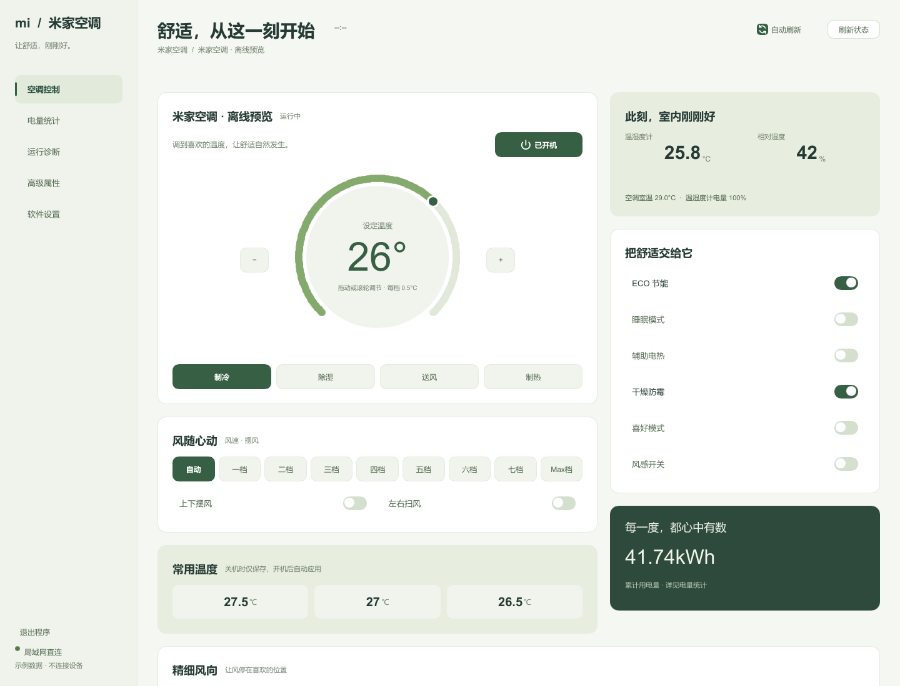

# 米家空调

一款使用 Rust 和 Slint 构建的 Windows 米家空调原生桌面控制器。支持局域网与云端连接、46 个型号的内置 MIoT 规格、设备控制、电量统计和运行诊断，提供浅色、深色、macOS、丛雨·亮色和丛雨·暗色五种主题，并可选安装 Codex 对话控制 Skill。



## 为什么使用它

- **本地优先**：优先通过局域网 miIO 连接设备；局域网不可用时可切换云端 RPC。
- **日常操作集中**：开关机、模式、目标温度、风速、摆风和舒适功能都在一个界面完成。
- **看得见设备状态**：提供电量统计、温湿度、运行诊断和高级属性读写。
- **适合长期运行**：单实例、系统托盘、自动刷新，以及关闭时“收进托盘 / 直接退出”的可记忆选择。
- **五种主题**：浅色、深色、macOS 与两种丛雨主题即时切换；支持开机自启动、日志滚动查看和导出。
- **原生且轻量**：不依赖 Electron、Chromium 或 Node.js；发布版启用体积优化与 LTO。
- **安全保存凭据**：新登录和旧凭据升级都使用当前 Windows 用户范围的 DPAPI 加密，保持自动连接。

## 下载与开始使用

从 [v2.3.0 发行版](https://github.com/zimo888u/mi-jia-kong-tiao/releases/tag/v2.3.0) 下载 Windows x86-64 便携版 `miac-app-v2.3.0-windows-x86_64.zip`，解压后运行 `miac-app.exe`。也可下载独立的 `miac-app.exe`。可选的对话控制 Skill 和文件校验值也在同一发行页提供。

首次启动时，点击“扫码登录米家账号”，使用米家 App 扫码并选择要控制的空调。程序会将凭据保存到当前 Windows 用户的米家空调数据目录。

## 功能概览

| 页面 | 能做什么 |
| --- | --- |
| 控制台 | 调节开关、模式、温度、风速、摆风和舒适功能 |
| 电量统计 | 查看日、月度用电信息 |
| 运行诊断 | 查看连接状态和设备运行信息 |
| 高级属性 | 读取或写入设备公开属性 |
| 软件主题 | 切换浅色、深色、macOS、丛雨·亮色和丛雨·暗色，自动保存偏好；丛雨主题包含 Q 版导航与功能区右侧立绘，暗色版使用纯黑全局背景 |
| 软件设置 | 开机自启动（默认关闭）、传输通道、自动刷新和关闭行为，滚动查看及导出本次运行日志 |
| 对话控制 Skill | 可选安装包，让 Codex 查询室温与空调状态，并按型号安全校验控制操作 |

## 多型号适配

- 内置 46 个小米、智米、云米空调型号的公开 MIoT 规格：36 个正式版、10 个预览或调试版；其他型号首次使用时尝试在线获取并缓存。
- 按设备的真实型号识别，而不是按“1 匹 / 1.5 匹 / 2 匹”猜测协议。匹数相同并不代表属性地址相同。
- 自动显示米家账号中的设备名称；没有名称时显示型号。
- 开关、温度范围与步长、模式、风速及可用摆风/舒适功能随型号变化，不支持的可选控制隐藏。
- 原机型 `xiaomi.airc.h53h00` 保留专属控制与电量历史；其他型号不套用其历史耗电键和私有诊断属性。其他型号的实时电量如有读数，会注明单位未经确认。
- `xiaomi.aircondition.ma1`、`ma2`、`ma4` 的公开规格版本对模式数字定义互相冲突，未取得设备精确版本前不提供模式写入；开关和温度仍按规格使用。
- 在线识别的型号如存在多个同级规格版本，也会禁用未确认的模式写入。
- 46 个规格均通过离线解析测试，**不代表 46 款真机均已测试**。预览或调试规格尤其需要真机确认；能否控制仍取决于设备固件、账号授权及网络连接。非米家 MIoT 空调不保证兼容。
- 完整内置型号见 [兼容性说明](docs/compatibility.md)。规格离线解析通过不代表每款型号都经过真机测试。

## 从源码运行

需要 Rust stable 工具链和 Windows SDK（用于嵌入应用图标）。

```powershell
cargo run -p miac-app
```

启动登录弹层：

```powershell
cargo run -p miac-app -- --login
```

命令行诊断工具：

```powershell
cargo run -p miac-cli -- status
cargo run -p miac-cli -- creds
```

## 开发验证

```powershell
cargo test --workspace --locked
cargo run -p miac-app --example ui-preview -- docs/ui-preview
```

`ui-preview` 不连接设备、不读取凭据，会导出各页面的五种主题预览图并检查温度控制、登录界面和运行日志滚动等交互。Windows 原生窗口的重绘与最小化恢复检查见 [窗口修复记录](docs/minimize-restore-2026-10-17.md)，五种主题下的日志滚动检查见 [日志修复记录](docs/runtime-log-scroll-2026-10-17.md)。

## 项目结构

```text
crates/miac-core/   miIO、云端 RPC、凭据、登录和设备控制核心
crates/miac-app/    Slint 桌面界面、Windows 托盘与应用图标
crates/miac-cli/    命令行诊断工具
docs/               UI 预览、验证资料与发行说明
```

## 兼容性与隐私

项目可读取 `%APPDATA%\米家空调` 内旧版客户端的 `device.json`、`cloud-session.json` 和 `thermometer.json`，启动时将可读的旧凭据升级为加密格式。程序不再自动搜索工作目录或 EXE 目录。新登录把账号、空调和温湿度计一起保存到 DPAPI 加密的 `login-state.json`，提交失败保留整组旧状态；没有温湿度计时清除旧关联。旧版 EXE 不支持这个事务文件，升级时应同步更新桌面端、CLI 和 Skill 助手。旧位置副本不会擅自删除。用户级 DPAPI 不能防止同一 Windows 用户身份运行的恶意程序读取凭据。请勿将凭据或令牌提交到仓库。

## 清理本机数据

在程序「软件设置」里点击「一键删除凭证」，确认后程序会退出，再删除当前用户的凭证、设备配置、软件设置、日志、型号缓存、旧版缓存和本软件专用注册表项，同时取消开机自启动。清理结束会显示结果，重新打开程序后需扫码登录。

也可先退出米家空调，再双击 [清理米家空调数据.cmd](清理米家空调数据.cmd)，由新版程序执行相同的清理。删除后需要重新扫码登录。

清理范围仅为 `%APPDATA%\米家空调` 和 `%LOCALAPPDATA%\米家空调`、本软件专用注册表项及 `Miac.Desktop.v2` 自启动项。工作目录、EXE 目录、项目目录、`dist` 和通用 `Software\miac` 注册表键会保留。链接根目录会被拒绝；遍历中通过 Windows 目录句柄防止目录被替换。旧版便携文件可由用户确认后自行处理。

两份审计的逐项修复和验证记录见 [2026-10-15 审计修复对照](docs/audit-remediation-2026-10-15.md)。

## 更新日志

完整记录见 [CHANGELOG.md](CHANGELOG.md)。
